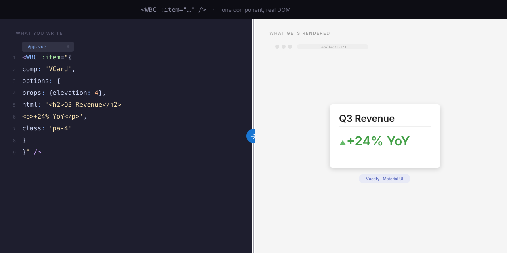
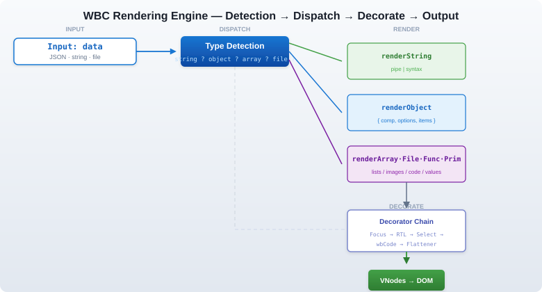
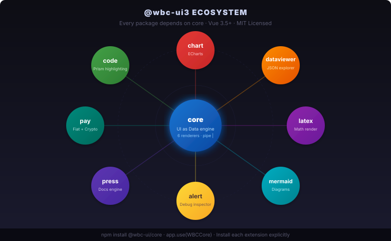

<p align="center">
  <strong>UI as Data. Vue 3. Unlimited.</strong><br/>
  <em>Define components as JSON. Let the engine render. Ship complex UIs in minutes, not weeks.</em>
</p>

<p align="center">


</p>

<p align="center">
  
</p>

---

## Why?

[Documentation → core.wbc-ui.com](https://core.wbc-ui.com)

**@wbc-ui/core** replaces the entire HTML/CSS/JS template stack with a single `<WBC>` tag driven by data.

### Write 10× less code

```javascript
// Before: 80 lines of <template>, <script>, methods, computed, v-if, v-for
// After: one line. One component.
<WBC :item="dynamicUIConfig" />
```

The engine understands **files**, **URLs**, **Markdown**, **code**, and **rich media** natively — no wrapper components, no special handling. Pipe `|` syntax gives you styling, linking, and type-override in a single string.

### Markdown becomes interactive

```html
<WBC :item="'./landing.md'" />
<!-- Renders a full markdown page with TOC, syntax-highlighted code blocks,
     anchor links, and copy buttons. The markdown IS the UI. -->
```

### Files and URLs as first-class citizens

```javascript
<WBC :item="'./chart-data.json'" />           // JSON → rendered
<WBC :item="'./hero.png|rounded elevation-4'" /> // image with Vuetify classes
<WBC :item="'./code-sample.py'" />            // Python → syntax-colored block
<WBC :item="'https://api.example.com/data'" /> // fetch → parse → render
<WBC :item="'https://youtu.be/dQw4w9WgXcQ'" /> // YouTube embed
```

### Replace HTML · CSS · JS with JSON

```javascript
// No <div>. No class="" strings. No event handlers in templates.
// Everything is an object. Everything is reactive.
{
  comp: 'VCard',
  options: {
    html: (ctx) => ctx.data.intro,                  // dynamic HTML
    class: (ctx) => ctx.dark ? 'dark-card' : null,  // conditional CSS
    on: { click: (ctx) => ctx.toggleFloat(true) },  // reactive events
    props: { elevation: 4 }
  },
  items: [
    './logo.png|ma-auto',                            // file with Vuetify classes
    { comp: 'VBtn', options: { html: '[[ CTA ]]' } } // WBHtml markup inside
  ]
}
```

> **One language. One component. One `<WBC>` tag.** No template files. No CSS files. No `<style scoped>`. Everything is data.

---

## What is @wbc-ui/core?

A **Vue 3.5+ plugin** that implements the **"UI as Data"** paradigm. You feed it a JSON object — it recursively builds a live, reactive UI.

| Renderer | Handles |
|---|---|
| `renderString` | Inline strings with pipe `\|` syntax: `"text\|class\|link\|parsedAs"` |
| `renderObject` | Component descriptors: `{ comp: 'VBtn', options: { … } }` |
| `renderArray` | Lists and grids with inheritance and disposition |
| `renderFile` | Images, videos, PDFs, code files, markdown |
| `renderFunction` | Lazy-evaluated render functions |
| `renderPrimitive` | Numbers, booleans, dates |

`<WBC :item="…">` is polymorphic — it dispatches to one of the six based on the JavaScript type of `item`.

**Who's it for?** Solutions architects, full-stack devs, low-code platform builders — anyone who needs to ship complex, data-driven UIs without drowning in templates.

> **Vue 3 only.** This package will not run on Vue 2 — it has no global `Vue` constructor, no `Vue.extend`, and touches only the app instance it is installed on. For the Vue 2 line use [`@wbc-ui2/core`](https://www.npmjs.com/package/@wbc-ui2/core).

---

## Usage Examples

### Level 1 — Hello World

```html
<WBC :item="'Welcome to @wbc-ui/core|text-h3 text-primary'" />
```

The pipe `|` separates content from styling — ½ second of typing.

### Level 2 — A full card

```html
<WBC :item="{
  comp: 'VCard',
  options: {
    props: { elevation: 4 },
    html: ['h2__Plans', 'p__Pick a view'],
    class: 'ma-4',
    on: { click: (ctx) => ctx.emit('selected', ctx.data) }
  }
}" />
```

### Level 3 — Reactive, data-driven, multilingual

```javascript
// This object could come from an API, a CMS, or a user-built form
const pageDefinition = {
  dive: true,                                  // enable reactive mode
  comp: (ctx) => ctx.lg.get() === 'ar'         // component changes by language
    ? 'VSheet' : 'VContainer',
  options: {
    html: (ctx) => ctx.data.intro[ctx.lg.get()], // pick localized content
    class: (ctx) => ctx.lg.get() === 'ar'
      ? 'text-right' : 'text-left'
  },
  items: [
    { comp: 'VAvatar', options: { props: { size: 64 } } },
    { comp: 'VBtn', options: { html: 'Pricing' } }
  ]
};
// One <WBC :item="pageDefinition" /> renders the entire page.
```

---

## Installation

### Prerequisites

- **Node.js** `^18` · `^20` · `>=22` — and **npm ≥ 9** (both declared in `engines`)
- **Vue 3.5+**
- A bundler that understands ESM exports: Vite (recommended), Webpack 5, or Rollup

### npm

```bash
npm install @wbc-ui/core@3.0.0-rc.1

# Peers — install only the ones you actually use
npm install vue@^3.5.0
npm install vuetify@^3.5.0 vue-router@^4.3.0   # optional
```

### Yarn / pnpm

```bash
yarn add @wbc-ui/core vue@^3.5.0
pnpm add @wbc-ui/core vue@^3.5.0
```

### Peer dependencies

| Package | Required? | Notes |
|---|---|---|
| `vue` (`^3.5.0`) | **required** | Vue 3 only. |
| `vuetify` (`^3.5.0`) | optional | Only if your descriptors reference Vuetify components. |
| `vue-router` (`^4.3.0`) | optional | Only for `WBLink` dynamic route registration. |
| `prettier` (`^3.0.0`) | optional | Only for code formatting. Absent → source is returned unformatted (never throws). |

**Nothing is auto-installed.** Per `_meta/adr_001_peer_stack.md` this package holds **no static peer imports** — it never pulls Vuetify, a router or a store into your bundle. `markdown-it` is the one exception: it is bundled and exposed as `app.config.globalProperties.$md`.

### Vue 3 plugin registration

```javascript
// main.js
import { createApp } from 'vue';
import WBCCore from '@wbc-ui/core';
import '@wbc-ui/core/styles.css';
import App from './App.vue';

const app = createApp(App);
app.use(WBCCore);
app.mount('#app');
```

`install` is **idempotent per app** — calling it twice on the same app is a no-op. Two `createApp()` instances on one page are independent, and each gets its own registration.

It registers three components on your app: **`WBC`**, **`WBHtml`** and **`WBLink`**.

### Content Trust

`<WBC>` and `<WBHtml>` treat descriptor strings as `contentTrust="external"` by default. External content uses the hardened AST sandbox, which is the correct mode for API data, URL payloads, user-authored records, and anything loaded from outside your app bundle.

Use `contentTrust="authored"` only for first-party descriptors you ship and review yourself, when they need the legacy interactive evaluator for handlers or framework-aware expressions:

```vue
<WBC :item="authoredPageDescriptor" contentTrust="authored" />
```

The deprecated `untrusted` prop remains for one release: `:untrusted="true"` maps to `contentTrust="external"`, and explicit `:untrusted="false"` maps to `contentTrust="authored"` with a migration warning. If both props are supplied with contradictory values, development builds reject the conflict and production resolves the subtree as `external`.

### Handing WBC your optional peers

WBC never imports Vuetify or a router, so if you want it to install one *for* you, pass the instance through `options.plugins`:

```javascript
import { createVuetify } from 'vuetify';
import router from './router';

app.use(WBCCore, {
  plugins: {
    Vuetify: { plugin: createVuetify(), property: '$vuetify' },
    Router:  { plugin: router }
  }
});
```

Recognised keys: **`Vuetify` · `Router` · `Store` · `JsonViewer` · `Cookies`**. An unrecognised key logs a warning rather than failing silently. If `property` is given and already present on the app, WBC skips the install instead of doubling it — so installing Vuetify yourself before `app.use(WBCCore)` is equally fine.

### Named imports

```javascript
import { WBC, WBHtml, WBLink, safeEval, strToObj } from '@wbc-ui/core';
```

### Ecosystem extensions

The core engine is intentionally small. Optional functionality lives in sibling packages — each is a Vue 3 plugin installed after core:

```javascript
import WBCCore   from '@wbc-ui/core';    // always first — extensions depend on it
import WBCode    from '@wbc-ui/code';    // code editor + Prism highlighting
import WBLatex   from '@wbc-ui/latex';   // KaTeX math rendering
import WBMermaid from '@wbc-ui/mermaid'; // Mermaid diagrams
import WBChart   from '@wbc-ui/chart';   // ECharts data visualization

app.use(WBCCore);
app.use(WBCode);
app.use(WBLatex);
app.use(WBMermaid);
app.use(WBChart);
```

### Troubleshooting common install errors

| Symptom | Cause | Fix |
|---|---|---|
| `Cannot read properties of undefined (reading 'use')` | `install` received something other than a Vue 3 app instance | Use `app.use(WBCCore)`, not `Vue.use(...)`. There is no global `Vue` in Vue 3. |
| Components render unstyled | Neither stylesheet was imported | `import '@wbc-ui/core/styles.css';` once in `main.js`. Vuetify's own CSS is your responsibility. |
| `[WBC] Unknown plugin key "…"` | A typo in `options.plugins` | Use one of `Vuetify`, `Router`, `Store`, `JsonViewer`, `Cookies`. |
| A `v-*` component renders as an unknown element | Vuetify isn't installed on the app | Install Vuetify yourself, or hand it to WBC via `options.plugins.Vuetify`. |
| `Multiple instances of Vue detected` | The bundler resolved Vue from two locations | Add a single `vue` alias in your bundler config; check with `npm ls vue`. |

---

## ⚡ The Engine Under the Hood

<p align="center">
  
</p>

- **6 renderers** dispatch on JavaScript type
- **Pipe syntax** for inline styling: `Hello|text-h4 text-primary|/docs|html`
- **`dive: true`** activates reactive mode — every property becomes a function of `(ctx)` state
- **Post-processing decorators** apply focus mode, RTL, selection overlays, and code rendering

---

## 🧭 Routing — UI as Routes

WBC doesn't only render content — any rendered block or link can become a **real, deep-linkable route**, registered on the fly and persisted across refresh. No edits to `router/index.js`.

### Self-registering routes — `options.route`

Give any item `options.route` and rendering it registers a permanent route on mount:

```javascript
<WBC :item="{
  comp: 'VCard',
  options: {
    route: 'Pricing',   // string → /wbc/Pricing
    // or: route: { name: 'Pricing', path: '/pricing', meta: { section: 'marketing' } }
    html: ['h1__Plans', 'p__Pick a view'],
  }
}" />

// After mount, /wbc/Pricing exists, renders this exact descriptor, and survives a refresh:
this.$router.push({ name: 'Pricing' });
```

The route **name is the unique key** — re-registering it with new content *overrides* the stored route. *(The earlier `options.name` / `options.path` still work but are deprecated.)*

Persistence is **storage-agnostic**: nothing is written anywhere until a host installs a sink.

```javascript
import { setWbcRouteSink } from '@wbc-ui/core';

setWbcRouteSink((routes) => localStorage.setItem('wbc:dynamicRoutes', JSON.stringify(routes)));
```

### Named routes from a plain string — `name__[path__]<payload>`

The 3rd pipe field of a string item is its link. Prefix it with a **route name** (and an optional path) and WBC registers a persisted route that **renders the payload through WBC**. The payload is any WBC item — a URL string, or an object/array descriptor (parsed with `strToObj`):

```html
<!-- payload = URL → rendered as  -->
<WBC item="open gallery | pa-2 | gallery__https://cdn.example.com/photo.jpg" />
<!--                              └ name ─┘  └────────── URL ──────────┘ -->

<!-- custom path -->
<WBC item="hero | pa-2 | hero__/media/hero__https://cdn.example.com/hero.jpg" />

<!-- payload = a WBC descriptor object → rendered as the page -->
<WBC item="open dashboard | pa-2 | dash__/dashboard__{ comp:'VCard', options:{ html:['h1__Dashboard'] } }" />

<!-- payload = an array (bracketed, or a bracket-less comma list) -->
<WBC item="open list | pa-2 | items__['<ul>','a','b','c']" />
<WBC item="open list | pa-2 | items__'<ul>','a','b','c'" />
```

`gallery` → `/wbc/gallery`; the optional middle segment sets a custom path. Since it's just text, a **grid of media becomes a few plain strings** — each tile a routable, refresh-safe WBC page.

### Every form at a glance

| `<link>` you write | Route | Renders |
|---|---|---|
| `gallery__https://…/p.jpg` | `/wbc/gallery` | the URL as `` (video / iframe / YouTube by type) |
| `hero__/media/hero__https://…/h.mp4` | `/media/hero` | URL with a **custom path** |
| `card__{ comp:'VCard', options:{ html:['h1__Hi'] } }` | `/wbc/card` | the **object** descriptor as the page |
| `items__['<ul>','a','b']` | `/wbc/items` | a **bracketed array** via `renderArray` |
| `items__'<ul>','a','b'` | `/wbc/items` | a **bracket-less** comma list (same result) |
| `Pricing` *(via `options.route`)* | `/wbc/Pricing` | the item registers **itself** on mount |

> **Gotchas:** the payload can't contain a raw `|` (escape `\|` or use the `h2__Text` shorthand); a single-key object `{a:1}` doesn't round-trip (add a 2nd key); names are a global key, so use unique names in loops. Nested `] ]` / `[ [` need a space or a `\`-escape so WBHtml's `[[ ]]` tokenizer doesn't eat them.

Untrusted content is blocked from registering routes at all.

---

## Fully Featured MIT Package

`@wbc-ui/core` ships one MIT-licensed package with no commercial tiers. Every consumer gets the
complete rendering engine: all renderers, `dive: true`, descriptor hooks, JS logic modules,
state helpers, framework accessors, decorator setters, route helpers, storage/cookie helpers,
markdown/AES/LZ-string utilities, validators, and uncapped data depth, collection length, and
`dayjs()` dates.

`__WBC_DEV__` remains a development-only opt-in for local inspection panels and trusted authoring
workflows. It is not a purchase signal, an entitlement mechanism, or a capability split.

---

## Exports

Every entry below is a named export of the package entry point.

| Export | Kind | Purpose |
|---|---|---|
| `install` | function | Vue 3 plugin installer — `install(app, options)`. |
| `WBC` | component options | The rendering-spine component (registered as `WBC`). |
| `WBHtml` | component | HTML / markdown rendering component. |
| `WBLink` | component | Router-aware link; auto-registers dynamic routes. |
| `safeEval` | function | Guarded expression evaluator (AST-sandboxed unless trusted). |
| `strToObj` | function | Parses a WBC descriptor string into an object. |
| `setWbcRouteSink` | function | Installs a storage-agnostic sink for dynamic route persistence. |
| `generalVal` | function | Descriptor value resolution helper. |
| `clone` | function | Deep-clone helper. |
| `excludeList` | function | Key-exclusion helper for descriptor objects. |
| `extendedInstall` | object | Lower-level installer used internally by `install`. |

Default export: `{ install }`.

> There is no `WBCPlugin` export. Use the default export or the named `install`.

---

## Styles

Two independent style entry points ship with the package:

```javascript
import '@wbc-ui/core/styles.css';   // compiled stylesheet (dist/index.css)
import '@wbc-ui/core/styles';       // raw source barrel (src/styles/index.js)
```

`styles.css` is the compiled output and is what most consumers want. The `styles` barrel exposes the un-compiled `markdown.css` source for hosts that prefer their own CSS pipeline.

Vuetify's stylesheet is **not** imported by this package — a host that uses Vuetify ships Vuetify's own CSS.

---

## Development Flag

The only WBC-specific compile-time constant read by core is `__WBC_DEV__`. Hosts may set it to
`true` in local builds to expose development inspection panels and trusted authoring workflows.
The published library build leaves it undefined, which defaults those development affordances off
for ordinary consumers.

---

## 🌐 Ecosystem

<p align="center">
  
</p>

`@wbc-ui/core` is the foundation of the **@wbc-ui3** monorepo. Every package below depends on it:

| Package | What it adds |
|---|---|
| `@wbc-ui/code` | Code editor + Prism syntax highlighting |
| `@wbc-ui/chart` | Apache ECharts integration |
| `@wbc-ui/dataviewer` | JSON / data-table explorer |
| `@wbc-ui/latex` | KaTeX math rendering |
| `@wbc-ui/mermaid` | Diagram-as-code rendering |
| `@wbc-ui/alert` | Floating debug / alert panel |
| `@wbc-ui/press` | Markdown-driven docs engine |
| `@wbc-ui/cli` | Project scaffolding CLI |
| `@wbc-ui/js` | View-folder application framework |
| `@wbc-ui/pay` | Payment and support-link hub |

---

## 📄 License

MIT © [Wissem Boughamoura](https://github.com/wissemb11) · [wi-bg.com](https://www.wi-bg.com) · [wbc-ui.com](https://wbc-ui.com)
